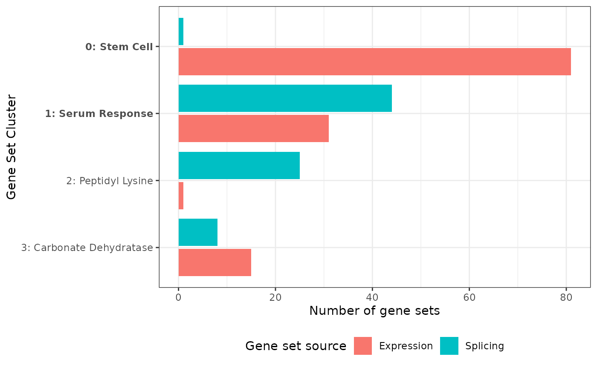
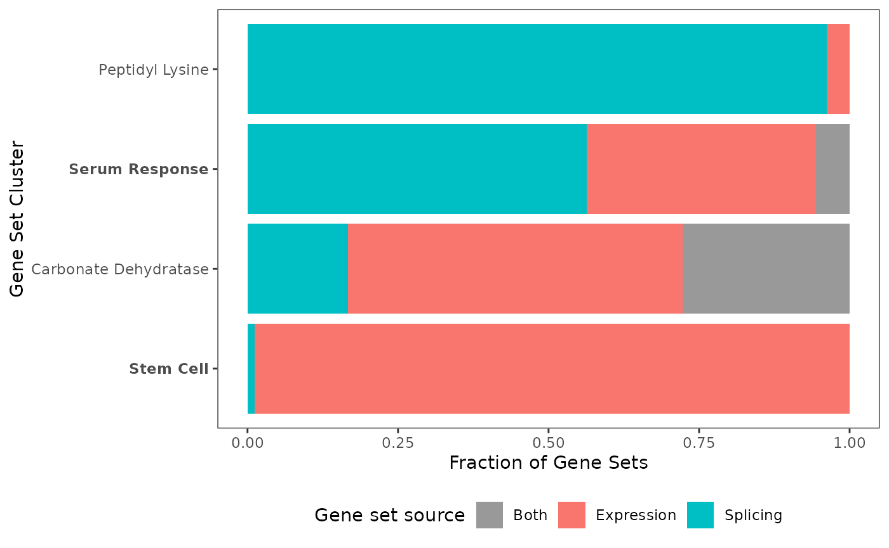
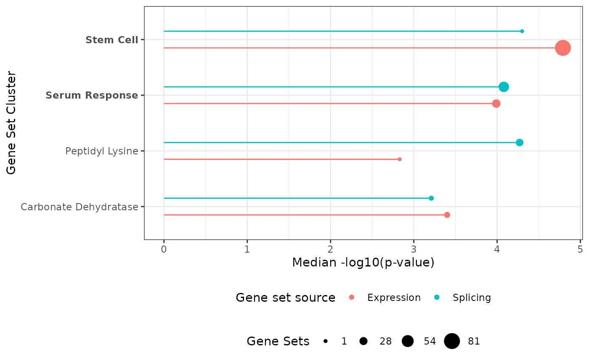
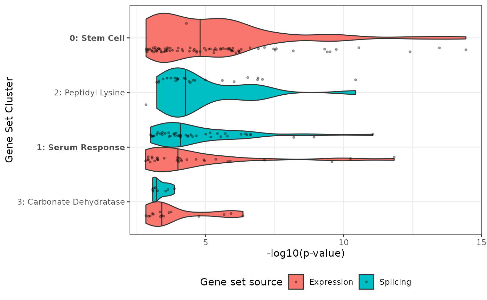
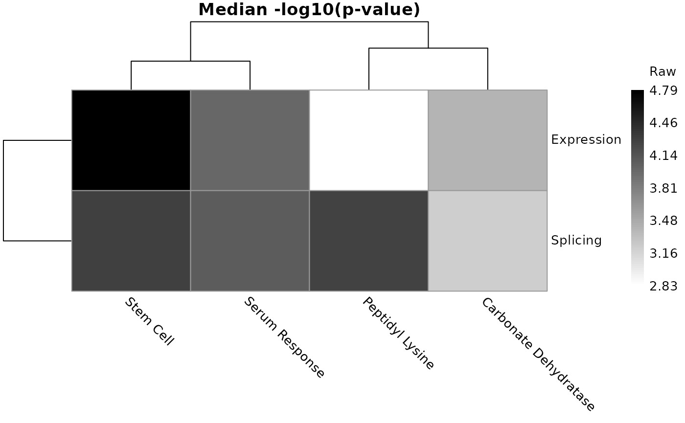
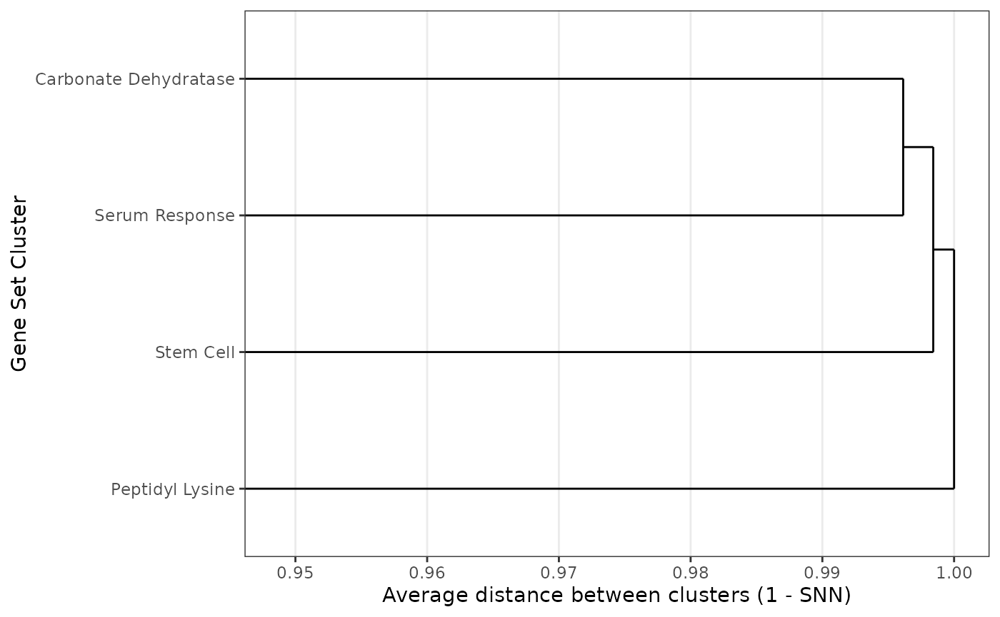
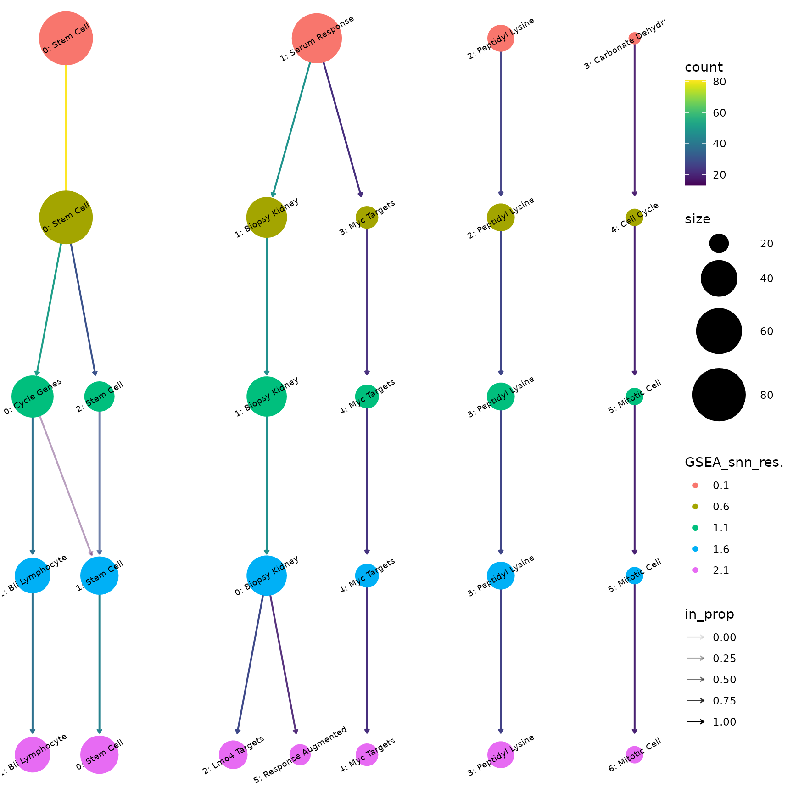

# Vignette for geneSetSimplifyR

## Background and Rationale

Gene-set enrichment analysis (GSEA) is one of the most useful types of
bioinformatic analysis since it summarizes long lists of genes
(e.g. TP53, CD1) into more high-level biological concepts (e.g. “cell
cycle”, “DNA repair”). While GSEA is potentially extremely powerful for
profiling the high-level biological changes in a system, this is often
hampered by very long lists of significant gene sets. This point is
demonstrated by our [recent
article](https://link.springer.com/article/10.1186/s12915-023-01724-w)
where we re-analyze 100 RNA-seq data sets and show the average dataset
had 1700+ gene sets significantly enriched among differentially
expressed genes.

It is naturally not possible to manually analyze such long lists, so in
practice scientists often just show the most significant/enriched
gene-sets or cherry-pick gene-sets based on prior biological hypothesis.
Neither is naturally desirable (or good scientific practice?), hence
approaches to analyzing such long lists of gene sets are needed.

That is why we created `geneSetSimplifyR`. `geneSetSimplifyR` solves
this problem by:

- Grouping gene-sets into a small number of highly redundant/overlapping
  clusters through unsupervised clustering
- Intelligently assigning labels to each cluster making it easy to
  figure out the core biology behind a cluster
- Providing a host of intuitive plots enabling both visualization and
  exploration of these clusters

`geneSetSimplifyR` works on the output from *any* gene-set enrichment
analysis tool but works especially well with
[fgsea](https://bioconductor.org/packages/fgsea/).

## Installation

`geneSetSimplifyR` can be installed from GitHub by copy pasting this
command into R. `BiocManager` installs the dependencies from both CRAN
and Bioconductor:

``` r

if (!requireNamespace("BiocManager", quietly = TRUE)) {
  install.packages("BiocManager")
}
BiocManager::install("remotes") # needed to install from GitHub
BiocManager::install("IsoformAnalysisGroup/geneSetSimplifyR")
```

This vignette is also available online at
<https://isoformanalysisgroup.github.io/geneSetSimplifyR/>.

## geneSetSimplifyR workflow

### Overview

`geneSetSimplifyR` works on the output from *any* gene-set enrichment
analysis tool but works especially well with
[fgsea](https://bioconductor.org/packages/fgsea/).

The input to `geneSetSimplifyR` is simply:

- A list of the gene-sets that should be clustered
- Optionally(!) metadata about the enrichment analysis that can be used
  for downstream visualization.

Specifically `geneSetSimplifyR` supports visualization of

- enrichment scores for each gene-set (e.g. NES, odds ratio, etc)
- p-values for each gene-set (shown as -log10 p-values)
- multi-conditional data (joint comparison of several analyses each
  finding gene-sets of interest).

The `geneSetSimplifyR` workflow has three parts:

1.  [Cluster and label gene-sets](#cluster-and-label-gene-sets)
2.  [Visual exploration of the gene-set
    clustering](#visual-exploration-of-the-gene-set-clustering)
3.  [Exploring and verifying
    clusters](#exploring-and-verifying-clusters)

Each part is elaborated on in the sections below.

### Cluster and label gene-sets

We start by loading the `geneSetSimplifyR` library and its associated
example data:

``` r

library(geneSetSimplifyR)
library(ggplot2) # for modifying the plots

data("exampleGeneSets")
data("exampleEnrichment")

### Or load your own gmt file (you can also pass the file path directly
### as 'geneSetsList' to geneSetSimplifyR()):
# exampleGeneSets <- fgsea::gmtPathways(path_to_your_gmt_file)
```

Let’s explore the data to see what it should look like

``` r

### The gene sets are a list
class(exampleGeneSets)
#> [1] "list"

### Where each entry is a gene set and its annotated genes
str(head(exampleGeneSets,2))
#> List of 2
#>  $ GOBERT_OLIGODENDROCYTE_DIFFERENTIATION_UP: chr [1:498] "AAAS" "ABCB1" "ADAM23" "AEN" ...
#>  $ FISCHER_DREAM_TARGETS                    : chr [1:819] "AAAS" "ABCB10" "ABCE1" "ABHD10" ...
```

``` r

head(exampleEnrichment, 2)
#> # A tibble: 2 × 5
#>   source     pathway                          enrichment_score      pval    padj
#>   <chr>      <chr>                                       <dbl>     <dbl>   <dbl>
#> 1 Expression GRADE_COLON_AND_RECTAL_CANCER_UP             1.22 0.0000110 0.00129
#> 2 Splicing   BENPORATH_NANOG_TARGETS                      1.12 0.0000931 0.00904
```

The *enrichment_score* can be used for visualization downstream and the
*source* column can be used to compare the results of multiple analyses.
A *pval* column with the p-value of each gene set can also be added; it
is then shown as -log10(p-value) by the plots that summarize the
clusters. Here the enrichment scores, p-values and adjusted p-values
come from `fgsea`. In this case the example data is a subset of the
colorectal data analyzed in [Vitting-Seerup & Sandelin
(2017)](https://aacrjournals.org/mcr/article/15/9/1206/268100/The-Landscape-of-Isoform-Switches-in-Human?guestAccessKey=)
where gene-set enrichment was done both for differentially expressed
genes (“Expression”) and differentially spliced genes (“Splicing”).

With the data read we are now ready to use `geneSetSimplifyR`. The main
functionalities are:

- Cluster gene-sets based on the overlap in genes annotated to the
  gene-sets
- Intelligently label the clusters from the most informative words in
  the gene-set name

All functionality is wrapped into the *geneSetSimplifyR()* function:

``` r

exampleGsList <- geneSetSimplifyR(
  geneSetsList = exampleGeneSets,
  geneSetsDF = exampleEnrichment,
  resolution = c(0.1, 0.6, 1.1, 1.6), # for quick run - delete when running on real data
  verbose = FALSE,
  removeFirstWord = TRUE # Set as TRUE because the gene sets we’re using have the authors’ names as their first word.
)

exampleGsList
#> A gsList object with 197 gene sets from 2 source(s) clustered into 4 labeled clusters.
#> Metadata:
#>   algorithm: louvain
#>   k (KNN): 14
#>   LSI elbow cutoff: 11
#>   selected resolution: 0.1
#>   n pathways: 197
```

Please note that:

1.  While the visualizations in `geneSetSimplifyR` have a deep
    integration with the enrichment scores and source annotation, these
    are neither needed nor used for the clustering/labeling. Therefore
    the *geneSetsDF* argument is optional.
2.  The *resolution* argument is the hyper-parameter that controls the
    “level” of clustering, with higher values typically resulting in
    more (smaller) clusters.
3.  Here we only use a few *resolution* values for a quick run on the
    example data. In practice we recommend using a wider range of
    resolutions because:

- They can be utilized and explored downstream
- `geneSetSimplifyR` picks a default *resolution* (the one with the
  highest silhouette score) from the ones tested

The default *resolution* picked from the silhouette score can be
inspected with:

``` r

extractResolution(exampleGsList)
#> [1] 0.1
```

Note that the silhouette-based default is only a starting point — we
strongly encourage users to inspect the clustering at multiple
resolutions (e.g. with
[`plotClustree()`](https://isoformanalysisgroup.github.io/geneSetSimplifyR/reference/plotClustree.md),
see below) and pick the resolution that best fits their data and
biological question.

  
  

### Visual exploration of the gene-set clustering

Now with the clustering and labeling done we are ready to explore the
data visually. If you did not run the code above to generate the example
dataset you can load the example gsList as follows:

``` r

data("exampleGsList")
exampleGsList
#> A gsList object with 197 gene sets from 2 source(s) clustered into 4 labeled clusters.
#> Metadata:
#>   algorithm: louvain
#>   k (KNN): 14
#>   LSI elbow cutoff: 11
#>   selected resolution: 0.1
#>   n pathways: 197
```

To get an overview of the clusters the simplest visualization is a bar
chart.

``` r

plotBarchart(
  geneSetsList = exampleGsList,
  highlightClusterNo = c(0,1)
)
```



The bar chart shows the number of gene sets in each cluster, per source.
With multi-source data this immediately highlights clusters dominated by
one source versus those shared between sources, which can suggest
biology specific to one source versus shared programs. Here, for
example, the “Stem Cell” cluster consists almost only of gene sets
enriched among differentially expressed genes, while the “Peptidyl
Lysine” cluster consists almost only of gene sets enriched among
differentially spliced genes.

Also note that the `highlightClusterNo` argument is available for most
plotting functions, making it easy to visually communicate which
clusters you think are most interesting (shown in bold).

We can also visualize the gene-set clusters in a UMAP plot:

``` r

plotUMAP(
  geneSetsList = exampleGsList,
  highlightClusterNo = c(0,1),
  removeClusterId = TRUE,
  pointAlpha = 1 # because there are relatively few gene-sets here
)
```


Which automatically plots the source as the shape. The UMAP plot
function has many arguments enabling fine-tuning of the plot, and
`interactive = TRUE` gives a plot where hovering over a point shows its
gene set. Here we just want to highlight the use of `removeClusterId`.
While the cluster numbers are useful for quick referral to clusters
(important later), it is often desirable to remove them. Hence the
`removeClusterId` argument (implemented in most plot functions) removes
the cluster number (e.g. the “1:” prefix in “1: Serum Response”).

We already mentioned how we see differences in cluster composition. This
can naturally also be directly visualized. Gene sets found in both
sources are counted once, as “Both”:

``` r

plotProportions(
  geneSetsList = exampleGsList,
  highlightClusterNo = c(0,1),
  removeClusterId = TRUE
)
```



We can also utilize the p-values and enrichment scores we have for each
gene set. The simplest visualization is a lollipop plot of each
cluster’s median -log10(p-value):

``` r

plotEnrichments(
  geneSetsList = exampleGsList,
  highlightClusterNo = c(0,1),
  removeClusterId = TRUE
)
```



Which value is plotted is controlled by `plotFrom`, and how the gene
sets of a cluster are summarized by `summaryStat` (‘median’, ‘max’ or
‘mean’). By default the -log10 p-values are plotted when available, else
the enrichment scores. Any numeric column you supplied in `geneSetsDF`
can be used, here the mean enrichment score:

``` r

plotEnrichments(
  geneSetsList = exampleGsList,
  plotFrom = 'enrichment_score',
  summaryStat = 'mean',
  removeClusterId = TRUE
)
```


But we can also visualize the values of all gene sets (by default the
-log10 p-values) in a violin plot:

``` r

plotViolin(
  geneSetsList = exampleGsList,
  highlightClusterNo = c(0,1),
  removeClusterId = FALSE
)
```



These plots are useful for showing differences in regulation (one
cluster being up-regulated while another is down-regulated).

With many sources (e.g. many conditions or time points), a heatmap with
one row per source gives a compact overview. Cells of clusters without
any gene set from a source are gray. With three or more sources, each
cluster is z-scored across the sources by default (see the `scaleCols`
argument):

``` r

plotHeatmap(
  geneSetsList = exampleGsList,
  removeClusterId = TRUE
)
```



We can investigate how the clusters relate to one another using the
per-cluster average dendrogram:

``` r

plotDendrogram(
  geneSetsList = exampleGsList,
  removeClusterId = TRUE
)
```



The dendrogram complements the UMAP: distances between clusters in a
UMAP are not always meaningful, while the dendrogram is computed
directly from the gene sets the clusters share. The distances are often
all close to 1, because few gene sets of different clusters are
neighbors, so the axis is zoomed in on the range of the merges.

### Exploring and verifying clusters

The most important thing to get right is the clustering “level”
controlled by the `resolution` argument (as shown above in the [Cluster
and label gene-sets](#cluster-and-label-gene-sets) section).
`geneSetSimplifyR` picks a sensible default automatically, but we always
recommend visualizing how different cluster resolutions affect the
clusters via the [clustree R
package](https://cran.r-project.org/web/packages/clustree/index.html)
here wrapped in the *plotClustree()* function:

``` r

plotClustree(
  exampleGsList,
  resolutionsToPlot = c(0.1, 0.6, 1.1, 1.6, 2.1) # a subset keeps the tree readable
)
```



This is a very powerful way to see how the gene-sets are distributed
into different clusters and for helping with verifying the clustering
“level”, as determined by the resolution, is correct.

This can naturally be followed up by e.g. a UMAP at a different
resolution — here resolution 0.6:

``` r

plotUMAP(
  geneSetsList = exampleGsList,
  resolution = 0.6,
  pointAlpha = 1
)
```


Please note the `resolution` parameter is also implemented for most
plotting functions and for
[`extractTable()`](https://isoformanalysisgroup.github.io/geneSetSimplifyR/reference/extractTable.md).
When it is left at `NULL`, the *active* resolution is used: the optimal
one found by
[`clusterGeneSets()`](https://isoformanalysisgroup.github.io/geneSetSimplifyR/reference/clusterGeneSets.md),
or the one you last chose with
[`updateResolution()`](https://isoformanalysisgroup.github.io/geneSetSimplifyR/reference/updateResolution.md)
or `updateClusterLabels(resolution = ...)`.

Let’s try to update the default resolution:

``` r

exampleGsList <- updateResolution(
  geneSetsList = exampleGsList,
  resolution = 0.6
)

exampleGsList
#> A gsList object with 197 gene sets from 2 source(s) clustered into 5 labeled clusters.
#> Metadata:
#>   algorithm: louvain
#>   k (KNN): 14
#>   LSI elbow cutoff: 11
#>   selected resolution: 0.6
#>   n pathways: 197
```

  

Once we have verified the cluster resolution is suitable (for your
analysis), we can move on to verifying the cluster labels. While we
spent a lot of time optimizing the approach `geneSetSimplifyR` uses to
extract informative labels for each cluster, it is not a perfect
process. Therefore we have built functionality to both explore and
change cluster labels.

``` r

plotClusterLabels(
  geneSetsList = exampleGsList,
  clusterNumber = 1,
  maxChar = 35 # shorten gene-set names to fit in vignette
) +
  theme_bw(base_size = 8) # make font smaller to fit in vignette
```


From which a LOT of summary info can be seen for this particular
cluster:

- The label TF-IDF meaning the two-words that are most enriched in this
  cluster compared to other clusters (bottom left)
- The gene-sets most central in the shared nearest neighbor (SNN) graph
  of the cluster (top right)
- The weighted TF IDF - that is the TF-IDF score of each label combined
  with the centrality of the gene sets it comes from (both scaled to 0-1
  and added). The top label defines the cluster label (top left).
- The most frequent words in the gene-set names (top mid)
- The most frequent genes in the gene-sets (bottom mid)
- The largest gene-sets in the cluster (bottom right)

We recommend that you always inspect the output from
*plotClusterLabels()* for ALL your clusters to ensure the labeling is
appropriate.

If you think the auto-generated cluster labels could be more precise,
you can manually override them. For example, cluster 1 contains the
serum response gene sets of Schlosser et al. If you determine that this
cluster is better described as “Serum Response” after checking the
[gene-set
information](https://www.gsea-msigdb.org/gsea/msigdb/human/geneset/SCHLOSSER_SERUM_RESPONSE_DN.html),
the gsList can be updated accordingly:

``` r

exampleGsList <- updateClusterLabels(
  geneSetsList = exampleGsList,
  clusterNumber = 1,
  newClusterName = 'Serum Response'
)

plotUMAP(
  geneSetsList = exampleGsList,
  pointAlpha = 1
)
```


To verify the clustering you can naturally also look at all the
gene-sets annotated to a cluster:

``` r

gsTable <- extractTable(
  geneSetsList = exampleGsList,
  summarize = FALSE
)

head(gsTable)
#>       source                                   pathway enrichment_score
#> 1 Expression GOBERT_OLIGODENDROCYTE_DIFFERENTIATION_UP         1.294445
#> 2 Expression                     FISCHER_DREAM_TARGETS         1.223318
#> 3 Expression         MEBARKI_HCC_PROGENITOR_FZD8CRD_UP         1.282581
#> 4 Expression            VECCHI_GASTRIC_CANCER_EARLY_UP         1.283857
#> 5 Expression    SOTIRIOU_BREAST_CANCER_GRADE_1_VS_3_UP         1.420683
#> 6 Expression          KOBAYASHI_EGFR_SIGNALING_24HR_DN         1.340100
#>           pval         padj nlog10pval   cluster initial_cluster_label
#> 1 3.637638e-15 2.210229e-11  14.439181 Stem Cell             Stem Cell
#> 2 3.314153e-14 1.006840e-10  13.479627 Stem Cell             Stem Cell
#> 3 3.863003e-13 9.388643e-10  12.413075 Stem Cell             Stem Cell
#> 4 2.789000e-11 4.236490e-08  10.554552 Stem Cell             Stem Cell
#> 5 1.832008e-10 2.023870e-07   9.737073 Stem Cell             Stem Cell
#> 6 3.091404e-10 2.889749e-07   9.509844 Stem Cell             Stem Cell
```

The `initial_cluster_label` column keeps the automatically generated
label of renamed clusters. We strongly recommend ALWAYS including this
table in the supplementary material of an article, as it is essential
for both transparency and reproducibility.

For reporting purposes this table can also be summarized:

``` r

gsSummary <- extractTable(
  geneSetsList = exampleGsList,
  summarize = TRUE
)

head(gsSummary)
#>       source         cluster enrichment mean enrichment sd genesets
#> 1 Expression       Stem Cell            1.27          0.07       80
#> 2   Splicing       Stem Cell            1.14            NA        1
#> 3 Expression  Serum Response            1.19          0.09       12
#> 4   Splicing  Serum Response            1.19          0.05       38
#> 5 Expression Peptidyl Lysine            1.25            NA        1
#> 6   Splicing Peptidyl Lysine            1.23          0.06       26
```

### Plot modifications

All visualization functions return a ggplot2 object, except
[`plotHeatmap()`](https://isoformanalysisgroup.github.io/geneSetSimplifyR/reference/plotHeatmap.md)
(a pheatmap object) and `plotUMAP(interactive = TRUE)` (a plotly
object):

``` r

data("exampleGsList")

p1 <- plotBarchart(
  geneSetsList = exampleGsList,
  highlightClusterNo = c(0,1)
)
inherits(p1, "ggplot")
#> [1] TRUE

p1
```


This also means all plots can easily be modified using standard ggplot2
operations:

``` r

p1 +
  ggtitle('New plot title')
```


Such ggplot2 operations are *really* easy to google since ggplot2 has
millions of users. So if you want to modify any plot in some way, just
google that in conjunction with ggplot2 and you will find your answer
(e.g. “ggplot2 change fill color”).

``` r

p1 + 
  scale_fill_manual(values = c('black','green'))
```


### Convenience parsers for common GSEA tools

`geneSetSimplifyR` ships small helpers that convert the output of
popular enrichment-analysis tools into the `geneSetsList` + `geneSetsDF`
pair
[`geneSetSimplifyR()`](https://isoformanalysisgroup.github.io/geneSetSimplifyR/reference/geneSetSimplifyR.md)
expects, so you don’t have to reshape the data by hand:

- [`parsePairedGSEA()`](https://isoformanalysisgroup.github.io/geneSetSimplifyR/reference/parsePairedGSEA.md)
  — parses a `pairedGSEA::paired_ora()` result. Each of the three blocks
  (`expression`, `splicing`, `paired`) is filtered by its own padj
  cutoff (`cutoff_exp`, `cutoff_splicing`, `cutoff_paired`) and
  contributes its surviving pathways as a separate `source`.
- [`parseFgsea()`](https://isoformanalysisgroup.github.io/geneSetSimplifyR/reference/parseFgsea.md)
  — parses a single
  [`fgsea::fgsea()`](https://rdrr.io/pkg/fgsea/man/fgsea.html) (GSEA) or
  [`fgsea::fora()`](https://rdrr.io/pkg/fgsea/man/fora.html) (ORA)
  result; filters by a `padj` cutoff and labels rows with a
  user-supplied `source` string. To combine several analyses into one
  multi-source clustering, run it once per analysis (with a distinct
  `source`), [`rbind()`](https://rdrr.io/r/base/cbind.html) the
  resulting `geneSetsDF`s and combine the `geneSetsList`s
  (e.g. `c(a, b)` followed by removing duplicated names).
- [`getGeneSets()`](https://isoformanalysisgroup.github.io/geneSetSimplifyR/reference/getGeneSets.md)
  — fetches MSigDB gene sets (via
  [msigdbr](https://cran.r-project.org/package=msigdbr)) by collection /
  sub-collection or by a vector of pathway names. Handy for building a
  `geneSetsList` from scratch or for inspecting the members of specific
  pathways after clustering.

The two parsers return a list with two elements, `geneSetsList` and
`geneSetsDF`, ready to pass straight into
[`geneSetSimplifyR()`](https://isoformanalysisgroup.github.io/geneSetSimplifyR/reference/geneSetSimplifyR.md).
[`getGeneSets()`](https://isoformanalysisgroup.github.io/geneSetSimplifyR/reference/getGeneSets.md)
returns a named list of gene sets that can be used as `geneSetsList`:

``` r

# pairedGSEA example
parsed <- parsePairedGSEA(
  oraResult       = oraResult, # output from pairedGSEA::paired_ora()
  geneSets        = mSigDB, # mSigDB gene sets
  cutoff_exp      = 0.05,
  cutoff_splicing = 0.05,
  cutoff_paired   = 0.05
)
gss <- geneSetSimplifyR(
  geneSetsList = parsed$geneSetsList,
  geneSetsDF   = parsed$geneSetsDF
)

# fgsea example is shown in the next section.
```

See
[`?parsePairedGSEA`](https://isoformanalysisgroup.github.io/geneSetSimplifyR/reference/parsePairedGSEA.md),
[`?parseFgsea`](https://isoformanalysisgroup.github.io/geneSetSimplifyR/reference/parseFgsea.md),
and
[`?getGeneSets`](https://isoformanalysisgroup.github.io/geneSetSimplifyR/reference/getGeneSets.md)
for the full argument list.

## How to do gene-set enrichment analysis/overrepresentation analysis

Let’s look at how to produce the input for `geneSetSimplifyR` via the
`fgsea` package and its example data:

``` r

library(fgsea)

data(examplePathways)
data(exampleRanks)
```

And here are the genes of interest (e.g. significant genes) from the
`fgsea` package:

``` r

sigGenes <- tail(names(exampleRanks), 750)
head(sigGenes)
#> [1] "105352" "18476"  "380912" "20788"  "57875"  "56175"
```

Then, we can run a simple over-representation analysis (ORA) or gene set
enrichment analysis (GSEA) using the `fgsea` package as follows:

``` r

# ORA example
oraRes <- fora(
  pathways = examplePathways,
  genes    = sigGenes,
  universe = names(exampleRanks)
)
head(oraRes[order(padj), ])
#>                                            pathway         pval         padj
#>                                             <char>        <num>        <num>
#> 1:                              5990980_Cell_Cycle 2.692788e-26 3.823760e-23
#> 2:                     5990979_Cell_Cycle,_Mitotic 2.327765e-25 1.652713e-22
#> 3:                    5991851_Mitotic_Prometaphase 3.588483e-21 1.698549e-18
#> 4: 5992217_Resolution_of_Sister_Chromatid_Cohesion 1.316533e-18 4.673693e-16
#> 5:                                 5991454_M_Phase 1.103607e-14 3.134243e-12
#> 6:            5991757_RHO_GTPases_Activate_Formins 6.216227e-14 1.471174e-11
#>    foldEnrichment overlap  size                                overlapGenes
#>             <num>   <int> <int>                                      <list>
#> 1:       3.642276      84   369 11799,12189,12236,12442,12448,12531,...[84]
#> 2:       3.835962      76   317 11799,12236,12442,12448,12531,12534,...[76]
#> 3:       6.829268      35    82 11799,12236,12442,12534,12615,14211,...[35]
#> 4:       6.702703      31    74 11799,12236,12442,12534,12615,16319,...[31]
#> 5:       3.884393      42   173 11799,12236,12442,12534,12615,14211,...[42]
#> 6:       5.538462      27    78 11799,12236,12615,16319,18817,20877,...[27]

# fgsea example
fgseaRes <- fgsea(pathways = examplePathways, 
                  stats    = exampleRanks)
head(fgseaRes[order(padj), ])
#>                                            pathway         pval         padj
#>                                             <char>        <num>        <num>
#> 1:                              5990980_Cell_Cycle 3.256130e-27 4.623704e-24
#> 2:                     5990979_Cell_Cycle,_Mitotic 1.426222e-25 1.012617e-22
#> 3:                    5991851_Mitotic_Prometaphase 5.533885e-18 2.619372e-15
#> 4: 5992217_Resolution_of_Sister_Chromatid_Cohesion 1.009684e-17 3.584380e-15
#> 5:                                 5991454_M_Phase 1.059322e-14 3.008474e-12
#> 6:         5991599_Separation_of_Sister_Chromatids 1.701655e-14 4.027251e-12
#>      log2err        ES      NES  size
#>        <num>     <num>    <num> <int>
#> 1: 1.3499257 0.5388497 2.680665   369
#> 2: 1.3110148 0.5594755 2.740362   317
#> 3: 1.0959293 0.7253270 2.925960    82
#> 4: 1.0864405 0.7347987 2.935897    74
#> 5: 0.9865463 0.5576247 2.536998   173
#> 6: 0.9759947 0.6164599 2.650487   116
#>                                      leadingEdge
#>                                           <list>
#> 1: 66336,66977,12442,107995,66442,19361,...[155]
#> 2: 66336,66977,12442,107995,66442,12571,...[141]
#> 3:  66336,66977,12442,107995,66442,52276,...[44]
#> 4:  66336,66977,12442,107995,66442,52276,...[40]
#> 5:  66336,66977,12442,107995,66442,52276,...[67]
#> 6:  66336,66977,107995,66442,52276,67629,...[50]
```

**Both ORA and GSEA results from fgsea can be used as input to our
package in the same way.** Below, we use the ORA results to demonstrate
this workflow.

``` r

parsed <- parseFgsea(oraRes, examplePathways, cutoff=0.05)

oraGsList <- geneSetSimplifyR(
  geneSetsList = parsed$geneSetsList,
  geneSetsDF   = parsed$geneSetsDF,
  verbose      = FALSE,
  removeFirstWord = TRUE # the names start with an id, e.g. 5990980_Cell_Cycle
)
oraGsList
#> A gsList object with 59 gene sets from 1 source(s) clustered into 10 labeled clusters.
#> Metadata:
#>   algorithm: louvain
#>   k (KNN): 8
#>   LSI elbow cutoff: 10
#>   selected resolution: 4.1
#>   n pathways: 59
plotEnrichments(oraGsList) # uses the -log10 p-values kept by parseFgsea()
```


## Session info

``` r

sessionInfo()
#> R version 4.6.1 (2026-06-24)
#> Platform: x86_64-pc-linux-gnu
#> Running under: Ubuntu 24.04.5 LTS
#> 
#> Matrix products: default
#> BLAS:   /usr/lib/x86_64-linux-gnu/openblas-pthread/libblas.so.3 
#> LAPACK: /usr/lib/x86_64-linux-gnu/openblas-pthread/libopenblasp-r0.3.26.so;  LAPACK version 3.12.0
#> 
#> locale:
#>  [1] LC_CTYPE=C.UTF-8       LC_NUMERIC=C           LC_TIME=C.UTF-8       
#>  [4] LC_COLLATE=C.UTF-8     LC_MONETARY=C.UTF-8    LC_MESSAGES=C.UTF-8   
#>  [7] LC_PAPER=C.UTF-8       LC_NAME=C              LC_ADDRESS=C          
#> [10] LC_TELEPHONE=C         LC_MEASUREMENT=C.UTF-8 LC_IDENTIFICATION=C   
#> 
#> time zone: UTC
#> tzcode source: system (glibc)
#> 
#> attached base packages:
#> [1] stats     graphics  grDevices utils     datasets  methods   base     
#> 
#> other attached packages:
#> [1] fgsea_1.38.0            ggplot2_4.0.3           geneSetSimplifyR_0.99.0
#> [4] BiocStyle_2.40.0       
#> 
#> loaded via a namespace (and not attached):
#>   [1] RColorBrewer_1.1-3     jsonlite_2.0.0         magrittr_2.0.5        
#>   [4] spatstat.utils_3.2-5   farver_2.1.2           rmarkdown_2.32        
#>   [7] fs_2.1.0               ragg_1.5.2             vctrs_0.7.3           
#>  [10] ROCR_1.0-12            memoise_2.0.1          spatstat.explore_3.8-3
#>  [13] htmltools_0.5.9        janeaustenr_1.0.0      sass_0.4.10           
#>  [16] sctransform_0.4.3      parallelly_1.48.0      KernSmooth_2.23-26    
#>  [19] bslib_0.12.0           htmlwidgets_1.6.4      tokenizers_0.3.0      
#>  [22] desc_1.4.3             ica_1.0-3              plyr_1.8.9            
#>  [25] plotly_4.12.1          zoo_1.9-1              cachem_1.1.0          
#>  [28] igraph_2.3.4           mime_0.13              lifecycle_1.0.5       
#>  [31] pkgconfig_2.0.3        Matrix_1.7-5           R6_2.6.1              
#>  [34] fastmap_1.2.0          fitdistrplus_1.2-6     future_1.80.0         
#>  [37] shiny_1.14.0           digest_0.6.39          tidytext_0.4.3        
#>  [40] patchwork_1.3.2        Seurat_5.6.0           tensor_1.5.1          
#>  [43] RSpectra_0.16-2        irlba_2.4.1            textshaping_1.0.5     
#>  [46] SnowballC_0.7.1        labeling_0.4.3         progressr_1.1.0       
#>  [49] spatstat.sparse_3.2-0  httr_1.4.9             polyclip_1.10-7       
#>  [52] abind_1.4-8            compiler_4.6.1         withr_3.0.3           
#>  [55] backports_1.5.1        S7_0.2.2               BiocParallel_1.46.0   
#>  [58] viridis_0.6.5          fastDummies_1.7.6      ggforce_0.5.0         
#>  [61] MASS_7.3-65            tools_4.6.1            lmtest_0.9-40         
#>  [64] otel_0.2.0             httpuv_1.6.17          future.apply_1.21.0   
#>  [67] goftest_1.2-3          glue_1.8.1             nlme_3.1-169          
#>  [70] promises_1.5.0         grid_4.6.1             checkmate_2.3.4       
#>  [73] Rtsne_0.17             cluster_2.1.8.2        reshape2_1.4.5        
#>  [76] generics_0.1.4         clustree_0.5.1         gtable_0.3.6          
#>  [79] spatstat.data_3.1-9    tidyr_1.3.2            data.table_1.18.6.1   
#>  [82] tidygraph_1.3.1        sp_2.2-4               utf8_1.2.6            
#>  [85] spatstat.geom_3.8-3    RcppAnnoy_0.0.23       ggrepel_0.9.8         
#>  [88] RANN_2.6.3             pillar_1.11.1          stringr_1.6.0         
#>  [91] spam_2.11-4            RcppHNSW_0.7.0         later_1.4.8           
#>  [94] splines_4.6.1          tweenr_2.0.3           dplyr_1.2.1           
#>  [97] lattice_0.22-9         survival_3.8-6         deldir_2.0-4          
#> [100] tidyselect_1.2.1       miniUI_0.1.2           pbapply_1.7-5         
#> [103] knitr_1.52             gridExtra_2.3.1        bookdown_0.48         
#> [106] scattermore_1.2        xfun_0.62              graphlayouts_1.2.5    
#> [109] matrixStats_1.5.0      pheatmap_1.0.13        stringi_1.8.9         
#> [112] yaml_2.3.12            evaluate_1.0.5         codetools_0.2-20      
#> [115] ggraph_2.2.2           tibble_3.3.1           BiocManager_1.30.27   
#> [118] cli_3.6.6              uwot_0.2.5             xtable_1.8-8          
#> [121] reticulate_1.47.0      systemfonts_1.3.2      jquerylib_0.1.4       
#> [124] Rcpp_1.1.2             globals_0.20.0         spatstat.random_3.5-2 
#> [127] png_0.1-9              spatstat.univar_3.2-0  parallel_4.6.1        
#> [130] pkgdown_2.2.1          dotCall64_1.2          listenv_1.1.0         
#> [133] viridisLite_0.4.3      scales_1.4.0           ggridges_0.5.7        
#> [136] SeuratObject_5.4.0     purrr_1.2.2            rlang_1.3.0           
#> [139] fastmatch_1.1-8        cowplot_1.2.0
```
